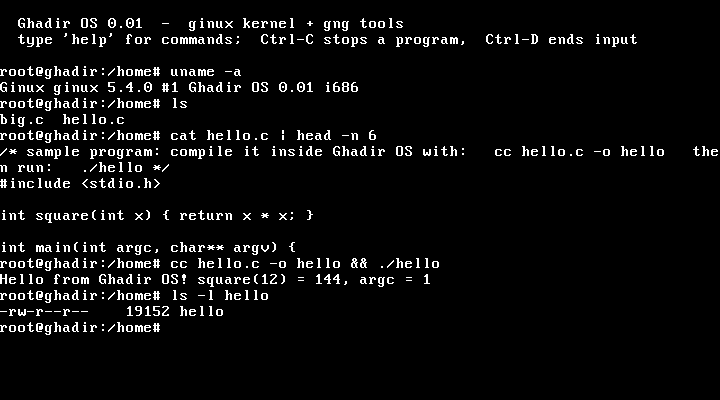

# نظام غدير (Ghadir OS)

**نظام تشغيل مكتوب من الصفر**: النواة **ginux** وأدواتها **gng**. مترجم C حقيقي (GCC 4.7.4) يعمل **فوق النواة** ويترجم البرامج داخل النظام وهو يعمل.

  -lightgrey)

[English](README.md) · [المعمارية](docs/ARCHITECTURE.md) · [ملاحظات التطوير](docs/HANDOFF.md) · [سجل التغييرات](CHANGELOG.md)

> **الإصدار 0.01 إصدار بحثي مبكر.** يقلع، وفيه shell تفاعلي، ويعمل عليه GCC ويترجم البرامج.
> وهو ليس نظاماً للاستعمال اليومي: لا قرص ولا شبكة ولا إشارات حقيقية بعد. انظر [الحدود المعروفة](#الحدود-المعروفة).

## البدء السريع

نزّل `ghadir-os-0.01.iso` من صفحة [الإصدارات (Releases)](../../releases) وشغّله بـ QEMU:

    qemu-system-i386 -cpu max -m 512 -cdrom ghadir-os-0.01.iso

اضغط داخل نافذة QEMU حتى تلتقط الكيبورد، ثم جرّب:

    root@ghadir:/home# help
    root@ghadir:/home# ls
    root@ghadir:/home# cc hello.c -o hello && ./hello
    Hello from Ghadir OS! square(12) = 144, argc = 1
    root@ghadir:/home# cat > t.c            # اكتب كود C وأنهِ بـ Ctrl-D
    root@ghadir:/home# cc t.c -o t && ./t; echo $?

المتطلبات: `qemu-system-i386`، و512MB ذاكرة للجهاز الافتراضي، والخيار `-cpu max` (النظام يستعمل ميزات CPUID وCMOV وSSE غير الموجودة بالمعالج الافتراضي).
كل الملفات في الذاكرة (RAM) وتضيع عند إغلاق النافذة. و`Ctrl-C` يوقف البرنامج الجاري، و`Ctrl-D` ينهي الإدخال.
شاشة VGA النصية لا تعرض العربية، لذلك الـ shell يتحدث بالإنجليزية.

## ما في المشروع

### `ginux/` : النواة
- x86 بـ 32 بت، مع PAE وNX، تقلع عبر GRUB (Multiboot)، وتدعم حتى 512MB من الذاكرة.
- جدولة استباقية (100Hz)، وعزل كامل لمساحة عناوين كل عملية مع **W^X** و**ASLR** وstack canaries، وخطأ برنامج المستخدم يقتله هو لا النواة.
- `fork` و`execve` و`waitpid` وpipes وTLS (`set_thread_area`) وحفظ حالة x87/SSE.
- نظام ملفات في الذاكرة قابل للكتابة وفيه مجلدات (صورة الإقلاع أرشيف USTAR)، وtty (كيبورد PS/2 وserial)، وشاشة VGA نصية.
- واجهتا syscalls: الواجهة الأصلية الصغيرة، و**طبقة توافق** تتبع أرقام i386 وقاعدة `-errno` (أكثر من 100 نداء) فتعمل برامج ساكنة غير معدَّلة مبنية على glibc أو dietlibc.
- أفكار تصميم مأخوذة من كتاب عربي في فلسفة إسلامية لبناء نظام تشغيل، ولكل منها تنفيذ حقيقي:
  **سجل لارجعي** لأحداث حياة العمليات، و**كشف الاحتكار** في أقفال النواة، و**نافذة الأمانة** التي تؤجل العمليات التي لا رجعة فيها
  (`rm` يُنفَّذ بعد نحو 3 ثوانٍ و`undo` يلغيه)، ونظام ملفات يفصل **الحقائق** (محتوى الملف) عن **الاعتباريات** (الأسماء والروابط).

### `gng/` : الأدوات التي تعمل فوق النواة
- `shell/`: **shell** تفاعلي (أنابيب، وتحويل المخارج، و`; && ||`، والاقتباس، والمتغيرات، و`*`، وأوامر داخلية، وسكربتات) و`cc` غلاف حول المترجم.
- `gcc/` و`binutils/` و`tcc/` و`dietlibc/`: سكربتات بناء **GCC 4.7.4** و**GNU binutils 2.45** و**TinyCC** و**dietlibc**، وكلها برامج ساكنة 32 بت تعمل داخل النظام.
- `glibc/`: برنامج glibc حديث ساكن يعمل على النواة، وسكربت لنقل **glibc 2.2** (سنة 2000) مستقبلاً (لم يُبنَ بعد).
- `demo/`: صورة اختبار آلية تشغّل كل الأدوات وتطبع ملخصاً.

## البناء من المصدر (Linux)

    sudo apt install build-essential gcc-multilib grub-pc-bin grub-common xorriso mtools qemu-system-x86

    make kernel           # النواة فقط
    make test             # اختبارات النواة على QEMU (تفشل عند أي خطأ، نحو دقيقة)
    make toolchain-lite   # dietlibc + TinyCC + shell (نحو 10 دقائق)
    make run-shell        # يبني dist/ghadir-os-0.01.iso ويشغّله
    make toolchain        # يبني أيضاً binutils وGCC 4.7.4 (ساعات على معالج واحد)، ثم `make shell`

`make help` يعرض كل الأهداف. الملفات التنفيذية للأدوات تُبنى بسكربتات `gng/*/build.sh` ولا تُرفع إلى المستودع (انظر `docs/THIRD_PARTY.md`).

## الاختبارات

كل الاختبارات تعمل فعلياً على QEMU:
- `make test`: **83** اختباراً للنواة والـ syscalls (fork وexec وpipes وTLS وذاكرة حتى 300MB وW^X وerrno…) مع عروض الـ ABI الأصلي.
- `gng/shell/test-shell.py <iso>`: **35** اختباراً للـ shell عبر serial (33 للصورة الخفيفة): التحويل والأنابيب و`undo` والترجمة بـ GCC داخل الـ shell، و`Ctrl-C` يقتل ترجمة جارية وعملياتها الفرعية.
- `gng/shell/test-gui.py <iso>`: **11** اختباراً لمسار النافذة الحقيقي: تُحقَن ضغطات مفاتيح PS/2 ثم تُقرأ ذاكرة شاشة VGA.

## الحدود المعروفة

قائمة صريحة بما ينقص أو هو خشن في 0.01:
- **لا تخزين دائم**: لا سائق قرص؛ الملفات في الذاكرة فقط.
- **لا تاريخ أوامر ولا أسهم** (الـ tty من النوع canonical فقط)، ولا jobs بالخلفية (`&`)، ولا `if/for/while`، ولا `2>`.
- **لا صلاحيات ملفات** (كل ملف يظهر `rw-r--r--`، ومستخدم واحد). **لا إشارات حقيقية** (`Ctrl-C` يقتل مباشرة)، ولا `select/poll`، ولا threads (`clone` يعمل كـ `fork` فقط)، ولا ربط ديناميكي، ولا شبكة، ومستخدم واحد (root)، ومعالج واحد.
- الذاكرة: `fork` ينسخ كل شيء (بلا copy-on-write)، و`mmap` يخصّص مسبقاً، وجداول الصفحات تتسرب عند موت العملية.
- شاشة VGA النصية لا تعرض العربية، فالـ shell يتحدث بالإنجليزية.
- كل الاختبارات على QEMU فقط (محاكاة TCG بلا KVM)؛ لم يُجرَّب على عتاد حقيقي.
- سكربتات بناء GCC وbinutils وTinyCC محققة، لكن إعادة بناء GCC كاملة تأخذ ساعات ولم تُكرَّر لهذا الإصدار.

## هيكل المستودع

    ginux/            النواة (boot/ و src/ و include/ وبرامج اختبار userland وtools/)
    gng/              الـ shell وسكربتات بناء الأدوات والعروض
    docs/             ARCHITECTURE.md وHANDOFF.md (ملاحظات التطوير بالعربية) وTHIRD_PARTY.md
    Makefile          الأهداف الرئيسية (make help)
    VERSION           0.01

## المساهمة والترخيص

المساهمات مرحَّب بها: انظر [CONTRIBUTING.md](CONTRIBUTING.md). الكود الأصلي تحت **رخصة MIT** ([LICENSE](LICENSE))،
والبرامج الخارجية المضمَّنة في الصور تحتفظ برخصها ([docs/THIRD_PARTY.md](docs/THIRD_PARTY.md)).
