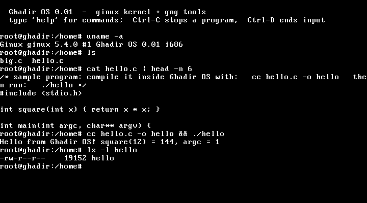

# Ghadir OS

**An operating system written from scratch**: the **ginux** kernel and the **gng** tool-chain. A C compiler (GCC 4.7.4) runs *on top of the kernel*
and compiles programs inside the running system.

  -lightgrey)

[العربية](README.ar.md) · [Architecture](docs/ARCHITECTURE.md) · [Development notes (Arabic)](docs/HANDOFF.md) · [Changelog](CHANGELOG.md)

> **Version 0.01 is an early research release.** It boots, has an interactive shell, and GCC compiles and runs programs on it.
> It is not a daily-driver OS: it has no disk, no network and no real signals yet. See [Limitations](#limitations).

## Quick start

Download `ghadir-os-0.01.iso` from the [Releases](../../releases) page and boot it in QEMU:

    qemu-system-i386 -cpu max -m 512 -cdrom ghadir-os-0.01.iso

Click inside the QEMU window so it grabs the keyboard, then try:

    root@ghadir:/home# help
    root@ghadir:/home# ls
    root@ghadir:/home# cc hello.c -o hello && ./hello
    Hello from Ghadir OS! square(12) = 144, argc = 1
    root@ghadir:/home# cat > t.c            # type some C, finish with Ctrl-D
    root@ghadir:/home# cc t.c -o t && ./t; echo $?

Requirements: `qemu-system-i386` (QEMU), 512 MB of RAM for the VM, and `-cpu max` (the system uses CPUID/CMOV/SSE features that the default CPU model lacks).
Everything lives in RAM and is lost when you close the window. Ctrl-C stops the running program, Ctrl-D ends input.

## What is inside

### `ginux/` : the kernel
- x86 32-bit, PAE with NX, booted by GRUB (Multiboot), up to 512 MB of RAM.
- Preemptive round-robin scheduler (100 Hz); per-process address spaces with **W^X**, **ASLR** and stack canaries; a fault in a user program kills that
  program, not the kernel.
- `fork`, `execve`, `waitpid`, pipes, thread-local storage (`set_thread_area`), x87/SSE state saving.
- A writable in-memory file system with directories (the boot image is a USTAR archive), a tty (PS/2 keyboard and serial) and a VGA text console.
- Two syscall ABIs: the kernel's original small one, and a **compatibility layer** that follows the i386 syscall numbers and `-errno` convention
  (100+ calls) so that unmodified static programs built against glibc or dietlibc run.
- Design ideas taken from an Arabic book on an Islamic philosophy of OS design, each with a real implementation:
  an **append-only ledger** of process life-cycle events, **monopoly detection** on kernel locks, a **trust window** that delays irreversible operations
  (`rm` takes effect after ~3 s and `undo` cancels it), and a file system that separates *facts* (file contents) from *conventions* (names, hard links).

### `gng/` : the tools that run on the kernel
- `shell/`: an interactive **shell** (pipes, redirection, `; && ||`, quoting, variables, globbing, builtins, scripts) and `cc`, a thin wrapper around the compiler.
- `gcc/`, `binutils/`, `tcc/`, `dietlibc/`: build scripts for **GCC 4.7.4**, **GNU binutils 2.45**, **TinyCC** and **dietlibc**, all static 32-bit
  programs that run inside Ghadir OS.
- `glibc/`: a modern static glibc program that runs on the kernel, and a script for a future **glibc 2.2** (year 2000) port (not built yet).
- `demo/`: an automated image that runs every tool and prints a summary.

## Build from source (Linux)

    sudo apt install build-essential gcc-multilib grub-pc-bin grub-common xorriso mtools qemu-system-x86

    make kernel           # the kernel only
    make test             # kernel test suites on QEMU (fails on any error, ~1 min)
    make toolchain-lite   # dietlibc + TinyCC + shell (~10 min)
    make run-shell        # build dist/ghadir-os-0.01.iso and boot it
    make toolchain        # also build binutils + GCC 4.7.4 (hours on one core), then `make shell`

`make help` lists every target. The toolchain binaries are built by `gng/*/build.sh` and are not committed (see `docs/THIRD_PARTY.md`).

## Tests

All tests run for real on QEMU:
- `make test`: **83** kernel/syscall tests (fork, exec, pipes, TLS, memory up to 300 MB, W^X, errno, ...) plus the original ABI demos.
- `gng/shell/test-shell.py <iso>`: **35** shell tests over the serial port (33 for the light image): redirection, pipelines, `undo`, compiling with GCC inside the shell, Ctrl-C killing a running compile and its child processes.
- `gng/shell/test-gui.py <iso>`: **11** tests of the real window path: PS/2 key presses are injected and the VGA text buffer is read back.

## Limitations

Honest list of what is missing or rough in 0.01:
- **No persistent storage**: there is no disk driver; files are in RAM only.
- **No line history or arrow keys** (the tty is canonical only); no job control (`&`), no `if/for/while`, no `2>`.
- **No file permissions** (every file shows `rw-r--r--`; single user). **No real signals** (Ctrl-C kills directly), no `select/poll`, no threads (`clone` only works like `fork`), no dynamic linking, no network, a single user (root), single CPU.
- Memory: `fork` copies everything (no copy-on-write); `mmap` allocates eagerly; page tables leak when a process dies.
- The VGA text console cannot show Arabic, so the shell speaks English.
- Everything was tested on QEMU only (TCG, no KVM); it has not been tried on real hardware.
- The GCC/binutils/TinyCC build scripts are verified, but a full GCC rebuild takes hours and was not repeated for this release.

## Repository layout

    ginux/            the kernel (boot/, src/, include/, userland test programs, tools/)
    gng/              shell, tool-chain build scripts, demos
    docs/             ARCHITECTURE.md, HANDOFF.md (development notes, Arabic), THIRD_PARTY.md
    Makefile          top-level targets (make help)
    VERSION           0.01

## Contributing, license

Contributions are welcome: see [CONTRIBUTING.md](CONTRIBUTING.md). The original code is under the **MIT License** ([LICENSE](LICENSE));
bundled third-party programs keep their own licenses ([docs/THIRD_PARTY.md](docs/THIRD_PARTY.md)).
